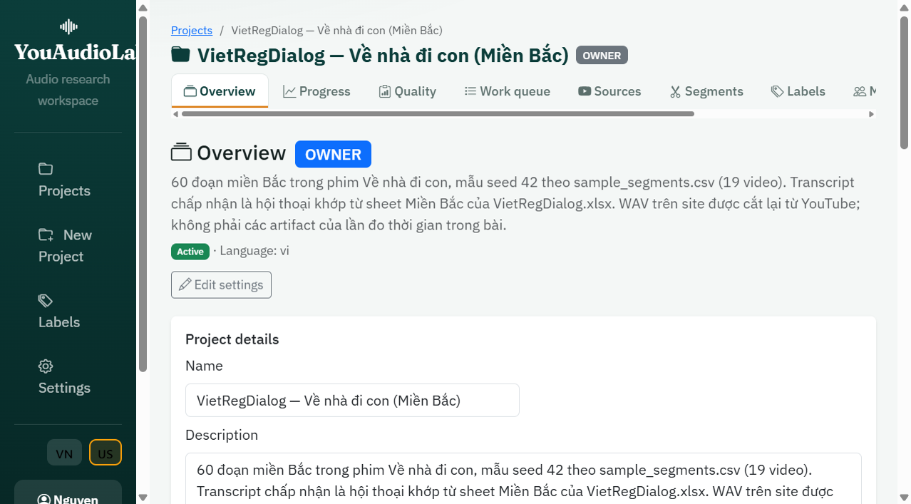
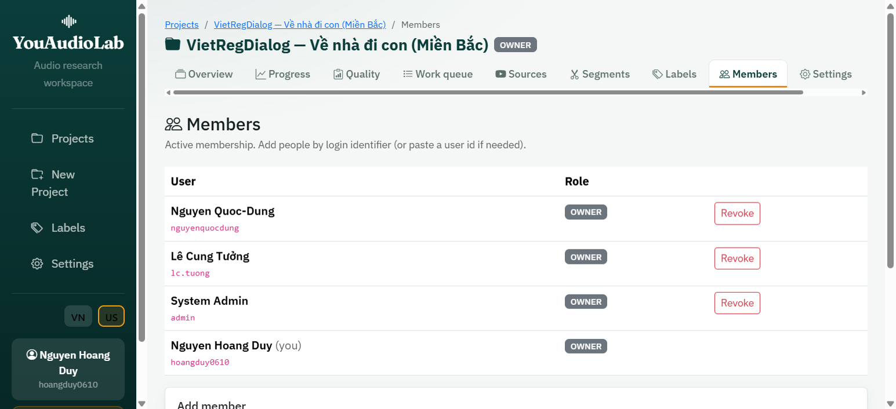
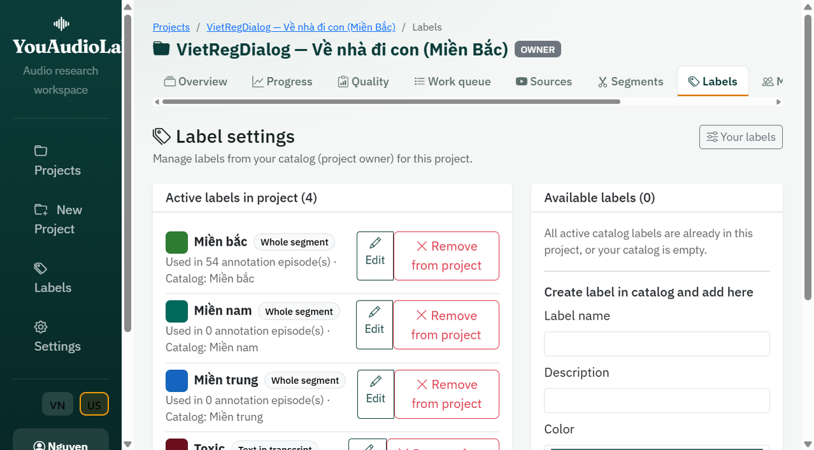
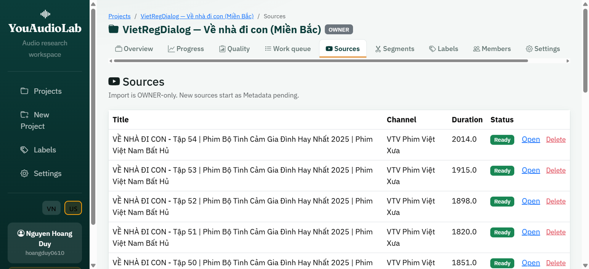
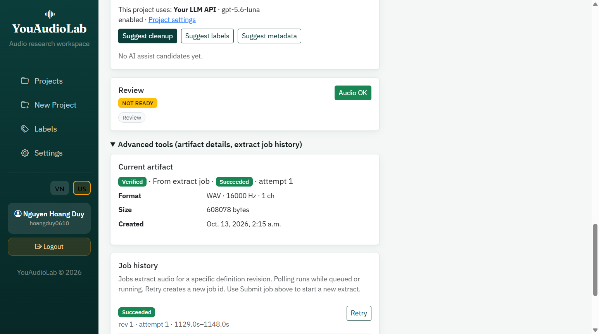
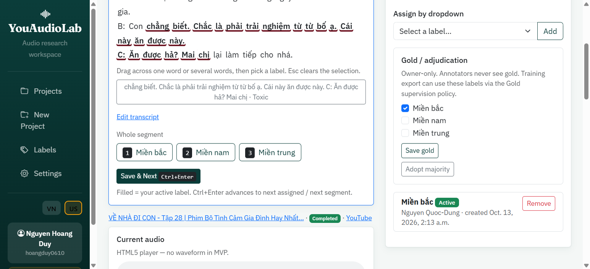
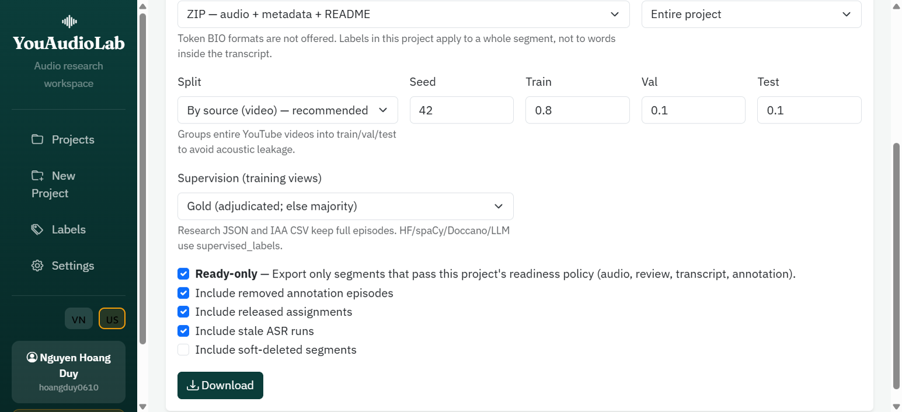

# Example: inspecting the VietRegDialog pilot UI

This page is an **interface inspection** of the hosted project
**[VietRegDialog — Về nhà đi con (Miền Bắc)](https://youaudiolab.duthu.net/projects/92652c59-5d8d-4223-9b5a-7ece25f8a591/)**.
It shows how protocol, verified audio, labels, gold, and export look in the
product UI. It is **not** a reproduction of manuscript §3.1 machine timing or
checksum trials, and it is **not** the §3.2 human–AI session. Those numbers
live in the manuscript and in
[README — Illustrative evaluation](../README.md#illustrative-evaluation).

Sign in with the [live demo account](../README.md#live-demo)
(`hoangduy0610`). Appendix screenshots under
[`software/figures/appendix/`](software/figures/appendix/) were captured from
this project on **27 Oct 2026**. If the live host changes, treat those PNGs as
the frozen UI reference; the URLs below are convenience links only.

The SoftwareX manuscript points here instead of embedding UI figures in the
article. The intended flow to read against §3.1 capabilities is: protocol →
source and cut → verified artifact → accepted transcript → labels / gold →
`by_source` export. Steps below mostly **inspect a pilot already built on the
host**, rather than clicking import → extract from an empty project.

## Sample shared with the evaluation

| Field | Value |
|---|---|
| Redistributed metadata | [`software/eval/sample_segments.csv`](software/eval/sample_segments.csv) (seed **42**, **60** segments, **19** distinct `video_id` values) |
| Live Quality summary at capture | **18** sources · **60** segments · license `research-only` |
| Example cut | Segment #1 · **1129.0–1148.0 s** · sample id **`MB_212`** · `video_id` `UyhV-OfRKfg` |
| Timed §3.1 media | Pre-extracted local MP3s (not redistributed). Host WAVs were cut from YouTube for this workspace and are a **different byte store**. |

The live Sources table showed one fewer Ready source than the 19 `video_id`
values in the CSV. Prefer the CSV (and an export snapshot) for video-level
membership; use the live UI to inspect controls and provenance fields.

## 1. Protocol

1. Open the project overview. Language is **`vi`**. Status is **Active**.

   

2. In **Settings**, audio defaults are **WAV / PCM / 16 kHz / mono**.
3. Readiness gates are on: **Audio OK**, a non-empty transcript, and at least
   one active annotation.
4. **Hide peer labels from annotators (blind)** is on. Owners still see every
   episode.
5. License is **`research-only`**. Consent notes state that pilot metadata
   comes from `sample_segments.csv` and that YouTube media is fetched by the
   platform worker.
6. **Members** lists four **OWNER** accounts (`nguyenquocdung`, `lc.tuong`,
   `admin`, `hoangduy0610`). This inspection does **not** demo a second
   annotator or overlap IAA. Add an **ANNOTATOR** and double-assign via **Work
   queue** when you need ≥2 labelers on one segment.

   

7. Project labels: whole-segment **`Miền bắc`**, **`Miền nam`**,
   **`Miền trung`**, plus optional **`Toxic`** (text-in-transcript). Progress
   at capture: **54** `Miền bắc` episodes; the other region labels unused.

   

## 2. Sources, cut, verified artifact, transcript

1. **Sources** lists imported YouTube episodes (channel *VTV Phim Việt Xưa*)
   with **Ready** after metadata succeeds. Importing a URL and creating new
   bounds is the usual empty-project path; here those rows already exist.

   

2. Open **Segment #1** on *VỀ NHÀ ĐI CON - Tập 28*, bounds
   **1129.0–1148.0 s** (19 s) · `definition_revision` **1**. This matches
   sample row **`MB_212`**.

3. **Verified artifact (I2 surface).** Under **Advanced tools → Current
   artifact**, the segment shows **Verified** from a succeeded extract job
   (attempt 1): **WAV · 16000 Hz · 1 ch**, size **608078** bytes, created
   13 Oct 2026. The workspace card does not print the SHA-256 string; that
   checksum is stored on the artifact and written into research JSON / the
   dataset ZIP when you export. Re-reading bytes against the stored digest on
   the §3.1 pilot files is covered by the integrity scripts under
   [`software/eval/`](software/eval/), not by this UI walk-through.

   

4. **Revision consistency (I1).** Saving new start/end bounds bumps
   `definition_revision`. A job still running against an older
   `expected_revision` is marked stale and cannot replace the current
   artifact. This EXAMPLE does **not** run that race on the live host; see
   [`software/eval/PROTOCOL.md`](software/eval/PROTOCOL.md) and the stale /
   race tests referenced there.

5. Accepted transcript on this segment:

   ```text
   A: Này.
   B: Dạ.
   A: Con có sợ mùi gì nữa không để hàng ngày nấu cơm bố tránh gia.
   B: Con chẳng biết. Chắc là phải trải nghiệm từ từ bố ạ. Cái này ăn được này.
   C: Ăn được hả? Mai chị lại làm tiếp cho nhá.
   ```

6. Project ASR is **local / PhoWhisper small**. A recognition candidate may
   differ from the accepted text; only **Use in transcript box** (or a manual
   edit) updates the canonical transcript. That apply step is the human gate
   between ASR history and the exported text.

   

## 3. Labels and gold on the same cut

1. Whole-segment chips: **`1 Miền bắc`**, **`2 Miền nam`**, **`3 Miền trung`**.
   On Segment #1 the active episode is **`Miền bắc`** (Nguyen Quoc-Dung).
2. Owner gold is also **`Miền bắc`**. Annotators never see gold while blind is
   on.
3. Optional schema demo: a **`Toxic`** character span on a dragged phrase.
   Spans travel in research JSON / `spans.csv`; they do not change
   whole-segment gold or Progress Jaccard / κ.
4. Blind and multi-annotator agreement are product features; this live project
   at capture did not show overlap (≥2 annotators on one segment). Use Work
   queue when you need those metrics.

## 4. Export (I3 surface)

1. **Export** → format **ZIP — audio + metadata + README**, supervision
   **`gold`**, split **`by_source`**, seed **`42`**, ratios
   **`0.8 / 0.1 / 0.1`**, **ready-only** as needed.

   

2. The ZIP places verified WAVs under `audio/` and points `metadata.csv` at
   each path beside transcript, times, title, and active spans.
3. `spans.csv` repeats the YouTube link and clip interval on each span row.
4. Research JSON keeps checksum, sample rate, annotator rows, gold,
   `supervised_labels`, `text_spans`, and split assignment. Schema:
   **`youaudiolab.research_dataset` 1.2**.
5. For Segment #1, gold training views keep **`Miền bắc`**. The Toxic span is
   not a whole-segment supervised label.
6. `by_source` assigns each video id to one fold; segments inherit that fold.
   `content_hash` ignores the export clock.

Word times from a recognition run are not written into these files. The
published item is the checksummed waveform with bounds, transcript, and
optional character spans.

## Open the same project

| Field | Value |
|---|---|
| Hosted project | [https://youaudiolab.duthu.net/projects/92652c59-5d8d-4223-9b5a-7ece25f8a591/](https://youaudiolab.duthu.net/projects/92652c59-5d8d-4223-9b5a-7ece25f8a591/) |
| Login | [README — Live demo](../README.md#live-demo) |
| Example segment | [Segment #1 · 1129.0–1148.0 s](https://youaudiolab.duthu.net/projects/92652c59-5d8d-4223-9b5a-7ece25f8a591/segments/ff1918bf-c77a-4258-9df5-8fe7af0c8fa9/) |
| Sample metadata | [`software/eval/sample_segments.csv`](software/eval/sample_segments.csv) (`MB_212`) |
| Screenshots captured | 27 Oct 2026 |
| §3.1 integrity scripts | [`software/eval/`](software/eval/) |

## Related reading

- [README — Live demo](../README.md#live-demo)
- [README — Illustrative evaluation](../README.md#illustrative-evaluation)
- [README — Building a corpus](../README.md#building-a-corpus)
- [README — Export formats](../README.md#export-formats)
- [software/eval/PROTOCOL.md](software/eval/PROTOCOL.md)
- SoftwareX manuscript drafts under [`software/`](software/)
